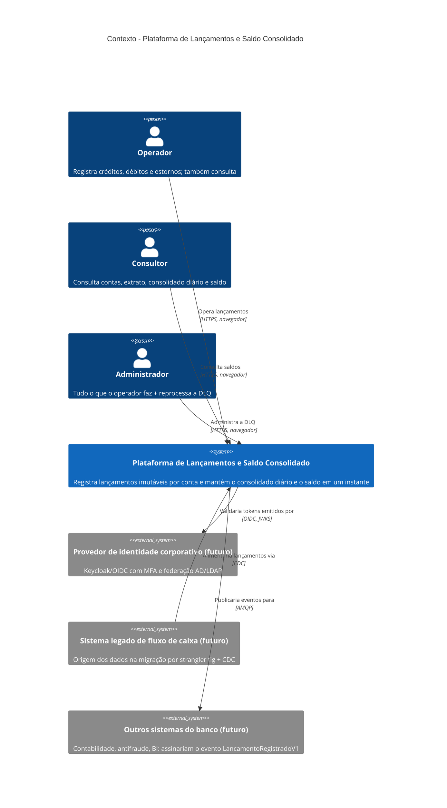

# C4 — Nível 1: Contexto

Quem usa a plataforma e com quais sistemas ela se relaciona. Os sistemas externos marcados como **futuro** não
existem nesta entrega: aparecem porque moldaram decisões (contrato de evento versionado, validação de token por
OIDC/JWKS, migração do legado) — veja [evolução](../evolucao.md).

**Legenda:** pessoa (azul-escuro) = papel de usuário; caixa azul = o sistema construído; caixa cinza = sistema
externo que **não** existe nesta entrega (evolução); seta = relação, com o protocolo entre colchetes.

## Elementos

| Elemento | Responsabilidade | Tecnologia |
|---|---|---|
| Operador | Registra crédito/débito e estorna lançamentos; consulta tudo | Navegador → portal web; papel `operador` no JWT |
| Consultor | Consulta contas, extrato, consolidado diário e saldo; não vê ações de escrita | Navegador; papel `consulta` |
| Administrador | Tudo o que o operador faz + `POST /api/v1/admin/dlq/reprocessar` | Navegador ou HTTP direto; papel `admin` |
| Plataforma de Lançamentos e Saldo Consolidado | Fonte de verdade dos lançamentos (imutáveis, idempotentes) e projeção assíncrona do consolidado diário/saldo | .NET 10, Next.js 16, PostgreSQL 17, Redis 7, RabbitMQ 4 — detalhada em [containers](02-containers.md) |
| Provedor de identidade corporativo (futuro) | Substituir a identidade própria (login, MFA, federação, refresh/revogação) | Keycloak / OIDC Authorization Code + PKCE |
| Sistema legado (futuro) | Origem dos lançamentos durante a migração; reconciliação diária de saldos | CDC (ex.: Debezium) |
| Outros sistemas do banco (futuro) | Consumir `lancamento.registrado.v1` sem acoplar ao serviço de lançamentos | Fila própria ligada à exchange `lancamentos.eventos` |

## Relações

| Relação | Descrição |
|---|---|
| Operador / Consultor / Administrador → Plataforma | Acesso pelo portal (`http://localhost:3000`), autenticado por login e senha; o papel no token define o que cada um vê e pode fazer |
| Plataforma → Provedor de identidade (futuro) | Hoje as APIs já validam o token pelo documento `/.well-known/openid-configuration` + JWKS da Identidade própria; trocar para o Keycloak é trocar `Autenticacao:EnderecoMetadados`, emissor e mapeamento de papéis |
| Legado → Plataforma (futuro) | Strangler fig: CDC do legado para Lançamentos, reconciliação diária, virada de leitura por conta |
| Plataforma → Outros sistemas (futuro) | O contrato `LancamentoRegistradoV1` é versionado e sem dados pessoais justamente para poder ser assinado por terceiros |

Próximo nível: [02 — Containers](02-containers.md).
