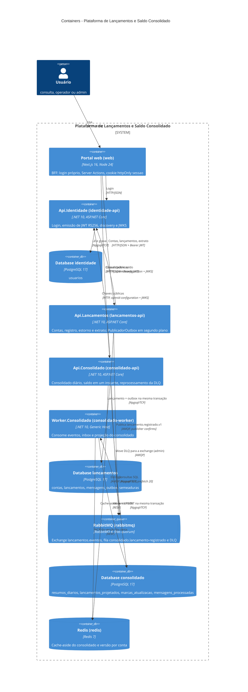
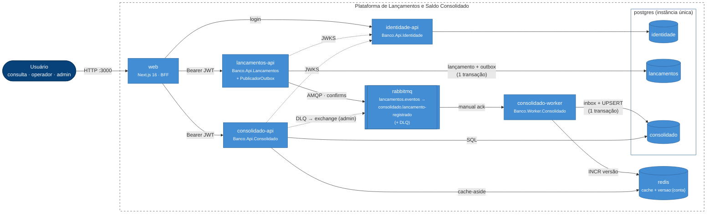

# C4 — Nível 2: Containers

Processos e armazenamentos que compõem a plataforma, exatamente como sobem no `docker-compose.yml` (nome do serviço
do compose entre crases). Cada API e o worker são **processos e imagens separados**, compilados a partir da mesma
solução em camadas ([D2](../decisoes-arquiteturais.md#d2-clean-architecture-organizada-por-camada-com-um-host-por-serviço)).

**Legenda:** caixa azul = container que executa código (um processo/imagem); cilindro = armazenamento;
fila = broker de mensagens; pessoa = usuário com um dos três papéis. Os três databases ficam **na mesma instância**
PostgreSQL (`postgres`), criados por `infra/postgres/01-criar-databases.sql`; nenhum serviço lê o database de outro.

## Mesma visão em flowchart

O layout automático do `C4Container` do Mermaid sobrepõe rótulos quando há muitas relações. A visão abaixo tem os
mesmos elementos e relações, com as cores da notação C4, organizada pelo caminho do dado (escrita à esquerda,
leitura à direita).

Linha tracejada = chamada que não está no caminho de cada requisição (chaves públicas cacheadas; reprocessamento da
DLQ sob demanda).

## Elementos

| Elemento | Responsabilidade | Tecnologia |
|---|---|---|
| `web` — Portal web | BFF: tela `/login` própria (Server Action `entrar`), grava o JWT no cookie `sessao` (httpOnly, `SameSite=Lax`, `Secure` com `COOKIE_SEGURO=true`); `proxy.ts` redireciona sem sessão para `/login?retorno=...`; Server Actions `registrar`/`estornar` e páginas `/contas`, `/contas/[contaId]`, `/contas/[contaId]/consolidado` chamam as APIs pelo servidor. O token nunca chega ao JavaScript do navegador | Next.js 16 (App Router, `output: "standalone"`), React 19, Tailwind 4; porta 3000 |
| `identidade-api` — `Banco.Api.Identidade` | `POST /api/v1/autenticacao/login` (rate limit por IP), `GET /.well-known/openid-configuration`, `GET /.well-known/jwks.json`; bloqueio após 5 falhas por 15 min | ASP.NET Core 10, JWT RS256, `PasswordHasher` (PBKDF2); porta 5000; volume `identidade-chaves` com o par RSA |
| `lancamentos-api` — `Banco.Api.Lancamentos` | `GET /api/v1/contas`, `GET/POST /api/v1/contas/{contaId}/lancamentos`, `POST .../lancamentos/{id}/estorno`; grava lançamento + `mensagens_outbox` numa transação; `PublicadorOutbox` (BackgroundService) publica os pendentes; migração e seed na subida | ASP.NET Core 10, EF Core + Npgsql, RabbitMQ.Client; porta 5001 |
| `consolidado-api` — `Banco.Api.Consolidado` | `GET /api/v1/contas/{contaId}/consolidado-diario?de&ate`, `GET .../saldo?em`, `POST /api/v1/admin/dlq/reprocessar?maximo=N` | ASP.NET Core 10, SQL via EF Core, StackExchange.Redis, Polly (circuit breaker); porta 5002 |
| `consolidado-worker` — `Banco.Worker.Consolidado` | Consome `consolidado.lancamento-registrado`, projeta com inbox + UPSERT, incrementa `versao:{conta}`; retry Polly e DLQ. Sem porta HTTP: saúde por arquivo de batimento | .NET 10 Generic Host, RabbitMQ.Client, Polly |
| `postgres` — database `identidade` | Usuários, hash de senha, tentativas e bloqueio | PostgreSQL 17 |
| `postgres` — database `lancamentos` | Fonte de verdade: contas, lançamentos imutáveis, outbox, marca do seed | PostgreSQL 17 |
| `postgres` — database `consolidado` | Projeção: deltas diários, movimentos para saldo intradiário, marca `atualizadoAte`, inbox | PostgreSQL 17 |
| `rabbitmq` | Exchange topic `lancamentos.eventos` → routing key `lancamento.registrado.v1` → fila quorum `consolidado.lancamento-registrado`, DLX `consolidado.dlx` (fanout) → `consolidado.lancamento-registrado.dlq` | RabbitMQ 4 (management em 15672) |
| `redis` | Chaves `consolidado:{conta}:{versao}:{de}:{ate}`, `saldo:{conta}:{versao}:{em}` e `versao:{conta}`; AOF ligado | Redis 7 |
| `k6` (profile `carga`, fora do diagrama) | Teste de carga do consolidado (`tests/carga/consolidado.js`) | grafana/k6 1.3.0 |

## Relações

| Relação | Descrição |
|---|---|
| Usuário → `web` | Navegador fala **só** com o Next.js; as APIs não têm CORS configurado, então não aceitam chamadas cross-origin do navegador |
| `web` → `identidade-api` | Server Action `entrar` faz `POST /api/v1/autenticacao/login`; `400`/`401` viram a mesma mensagem genérica |
| `web` → `lancamentos-api` / `consolidado-api` | `lib/api.ts` (server-only) envia `Authorization: Bearer <token do cookie>` e, nas escritas, `Idempotency-Key` gerada ao abrir o formulário |
| APIs → `identidade-api` | `AddJwtBearer` com `MetadataAddress` = `Autenticacao:EnderecoMetadados` (`http://identidade-api:8080/.well-known/openid-configuration`); chaves cacheadas e renovadas pelo próprio handler. Identidade fora impede **novos logins**, não derruba tokens já emitidos |
| `lancamentos-api` → database `lancamentos` | Lançamento e `mensagens_outbox` no mesmo `SaveChanges` (`UnidadeDeTrabalhoLancamentos`) |
| `lancamentos-api` → `rabbitmq` | `PublicadorOutbox`: lotes de 100 com `FOR UPDATE SKIP LOCKED`, publisher confirms + `mandatory`, `message_id` = id do lançamento, cabeçalho `x-correlation-id`. O broker **não** entra no `/health/ready` desta API |
| `rabbitmq` → `consolidado-worker` | `ConsumidorLancamentosRegistrados`, `autoAck: false`, prefetch 20; rejeição sem requeue vai para a DLQ |
| `consolidado-worker` → database `consolidado` | `ProjetarLancamento` em uma transação: `mensagens_processadas` (inbox) + UPSERT `resumos_diarios` + `lancamentos_projetados` + `marcas_atualizacao` |
| `consolidado-worker` → `redis` | `INCR versao:{conta}` depois do COMMIT (melhor esforço; Redis fora só gera log) |
| `consolidado-api` → `redis` / database `consolidado` | `ConsultasConsolidadoEmCache` (decorator) → `ConsultasConsolidado` (SQL). Redis fora: circuito abre, consultas vão ao Postgres e `/health/ready` responde `503` |
| `consolidado-api` → `rabbitmq` | Só no reprocessamento da DLQ (admin); a conexão é aberta sob demanda e o broker não entra na prontidão |

## Saúde e subida

- Todas as APIs expõem `/health/live` e `/health/ready`. Como a imagem `aspnet` não tem `curl`/`wget`, o
  healthcheck do compose roda o próprio binário: `dotnet Banco.Api.X.dll --verificar-saude` (GET em `/health/live`).
- O worker não tem HTTP: `PublicadorBatimentoSaude` regrava um arquivo a cada 5 s enquanto Postgres e o canal do
  consumidor estão saudáveis; `dotnet Banco.Worker.Consolidado.dll --verificar-saude` falha se o batimento tiver
  mais de 30 s.
- Prontidão por serviço: Identidade = `postgres-identidade`; Lançamentos = `postgres-lancamentos` (RabbitMQ fora de
  propósito); Consolidado API = `postgres-consolidado` + `redis`; Worker = `postgres-consolidado` + `rabbitmq-consumidor`.
- `depends_on: service_healthy` encadeia a subida: Postgres/Redis/RabbitMQ → Identidade → Lançamentos/Consolidado →
  web.

Próximo nível: componentes de [Identidade](03-componentes-identidade.md),
[Lançamentos](03-componentes-lancamentos.md) e [Consolidado](03-componentes-consolidado.md).
