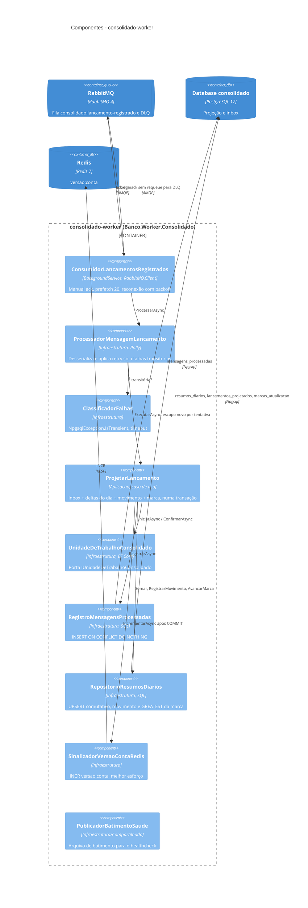
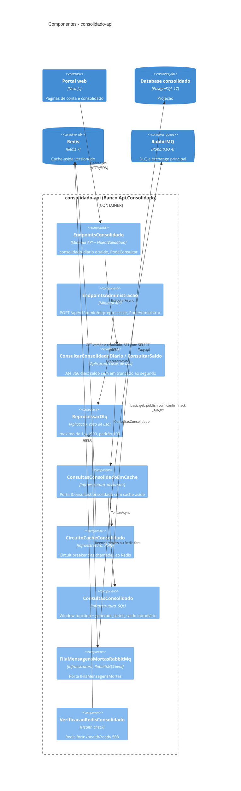

# C4 — Nível 3: Componentes do Consolidado

O contexto Consolidado roda em **dois containers** a partir do mesmo código (`Banco.Aplicacao/Consolidado`,
`Banco.Infraestrutura/Consolidado`), cada um compondo só o que usa:

- `consolidado-worker` (`Banco.Worker.Consolidado`): `AdicionarInfraestruturaConsolidado` +
  `AdicionarConsumidorConsolidado` — lado de **escrita da projeção**.
- `consolidado-api` (`Banco.Api.Consolidado`): `AdicionarInfraestruturaConsolidado` + `AdicionarConsultasConsolidado`
  + `AdicionarReprocessamentoDlqConsolidado` — lado de **leitura** e administração da DLQ.

## Worker (projeção)

## API (leitura e DLQ)

**Legenda:** como no [nível 3 da Identidade](03-componentes-identidade.md): componentes dentro da fronteira,
containers vizinhos fora, camada indicada na tecnologia.

## Mesma visão em flowchart

Os dois containers do contexto lado a lado, com os mesmos componentes dos diagramas C4 acima; o rótulo das setas é
a porta da Aplicacao.

```mermaid
flowchart LR
  rabbit[["RabbitMQ<br/>consolidado.lancamento-registrado<br/>+ DLQ"]]:::banco
  web["Portal web"]:::ext
  subgraph worker["consolidado-worker"]
    consumidor["ConsumidorLancamentosRegistrados"]:::host
    processador["ProcessadorMensagemLancamento<br/><small>retry Polly + ClassificadorFalhas</small>"]:::infra
    projetar["ProjetarLancamento<br/><small>Aplicacao</small>"]:::app
    uow["UnidadeDeTrabalhoConsolidado"]:::infra
    inbox["RegistroMensagensProcessadas"]:::infra
    resumos["RepositorioResumosDiarios"]:::infra
    versao["SinalizadorVersaoContaRedis"]:::infra
  end
  subgraph api["consolidado-api"]
    epCons["EndpointsConsolidado"]:::host
    epAdm["EndpointsAdministracao"]:::host
    consultar["ConsultarConsolidadoDiario<br/>ConsultarSaldo<br/><small>Aplicacao</small>"]:::app
    reproc["ReprocessarDlq<br/><small>Aplicacao</small>"]:::app
    cache["ConsultasConsolidadoEmCache<br/><small>decorator + CircuitoCacheConsolidado</small>"]:::infra
    sql["ConsultasConsolidado<br/><small>SQL</small>"]:::infra
    dlq["FilaMensagensMortasRabbitMq"]:::infra
  end
  pgcons[("database consolidado")]:::banco
  redis[("Redis")]:::banco

  rabbit --> consumidor --> processador --> projetar
  projetar -- "IUnidadeDeTrabalhoConsolidado" --> uow
  projetar -- "IRegistroMensagensProcessadas" --> inbox
  projetar -- "IRepositorioResumosDiarios" --> resumos
  projetar -- "ISinalizadorVersaoConta" --> versao
  inbox --> pgcons
  resumos --> pgcons
  versao -- "INCR" --> redis
  web --> epCons --> consultar
  epAdm --> reproc
  consultar -- "IConsultasConsolidado" --> cache
  cache -- "hit" --> redis
  cache -- "miss / Redis fora" --> sql --> pgcons
  reproc -- "IFilaMensagensMortas" --> dlq --> rabbit

  classDef ext fill:#999999,stroke:#6b6b6b,color:#fff
  classDef host fill:#85bbf0,stroke:#5d82a8,color:#000
  classDef app fill:#85bbf0,stroke:#5d82a8,color:#000
  classDef dom fill:#85bbf0,stroke:#5d82a8,color:#000
  classDef infra fill:#85bbf0,stroke:#5d82a8,color:#000
  classDef banco fill:#438dd5,stroke:#2e6295,color:#fff
```

## Elementos

| Elemento | Responsabilidade | Tecnologia |
|---|---|---|
| `ConsumidorLancamentosRegistrados` | Consome `consolidado.lancamento-registrado` com `autoAck: false` e prefetch 20 (`OpcoesConsumidorConsolidado`); só confirma depois da projeção gravada; `Confirmar` ⇒ ack, `Rejeitar` ⇒ `nack(requeue: false)` ⇒ DLX `consolidado.dlx` ⇒ DLQ. Coloca `x-correlation-id` e `IdMensagem` no contexto de log. Canal aberto é o health check `rabbitmq-consumidor` | RabbitMQ.Client 7 |
| `ProcessadorMensagemLancamento` | Desserializa `LancamentoRegistradoV1` (JSON inválido ⇒ DLQ direto) e executa `ProjetarLancamento` num escopo DI novo por tentativa, com retry Polly: 3 novas tentativas, backoff exponencial com jitter a partir de 1 s, só para falhas transitórias | Polly.Core |
| `ClassificadorFalhas` | Transitória = `NpgsqlException.IsTransient`, `TimeoutException` (inclusive embrulhadas em `DbUpdateException`); o resto (evento inválido, erro de SQL, bug) vai direto para a DLQ | — |
| `ProjetarLancamento` | Caso de uso (D7). Numa transação: `mensagens_processadas` (já existe ⇒ `Duplicado`, nada muda) → UPSERT do delta em `resumos_diarios` → `lancamentos_projetados` → `marcas_atualizacao` (GREATEST). Depois do COMMIT, sinaliza a versão — **também** na duplicata, para cobrir queda entre COMMIT e Redis | `Banco.Aplicacao/Consolidado` |
| `UnidadeDeTrabalhoConsolidado` | `IUnidadeDeTrabalhoConsolidado.IniciarAsync` devolve `ITransacaoConsolidado`; descartar sem confirmar faz ROLLBACK | EF Core |
| `RegistroMensagensProcessadas` | Inbox: `INSERT ... ON CONFLICT (id_mensagem) DO NOTHING`; entregas simultâneas serializam na PK | SQL via EF Core |
| `RepositorioResumosDiarios` | `creditos = creditos + EXCLUDED.creditos`, `debitos = debitos + EXCLUDED.debitos`: somas comutativas ⇒ ordem de chegada irrelevante | SQL via EF Core |
| `SinalizadorVersaoContaRedis` | `INCR versao:{conta}`; Redis fora só gera log (o dado já está no Postgres e o cache tem TTL) | StackExchange.Redis |
| `PublicadorBatimentoSaude` | Roda as verificações (`postgres-consolidado`, `rabbitmq-consumidor`) a cada 5 s e regrava o arquivo de batimento; `--verificar-saude` falha com batimento > 30 s | Generic Host |
| `EndpointsConsolidado` | `GET /api/v1/contas/{contaId}/consolidado-diario?de=&ate=` e `GET .../saldo?em=`; toda resposta traz `atualizadoAte` | Minimal API |
| `EndpointsAdministracao` | `POST /api/v1/admin/dlq/reprocessar?maximo=N` (só `admin`) | Minimal API |
| `ConsultarConsolidadoDiario`, `ConsultarSaldo` | Validam o intervalo (≤ 366 dias). Sem `em`, o saldo usa "agora" **truncado ao segundo**, para consultas próximas caírem na mesma chave de cache | `Banco.Aplicacao/Consolidado` |
| `ConsultasConsolidadoEmCache` | **Decorator** de `IConsultasConsolidado` (registrado como a porta; `ConsultasConsolidado` é injetado concreto). Chaves `consolidado:{conta}:{versao}:{de}:{ate}` e `saldo:{conta}:{versao}:{em}`; TTL 10 min se só há dias passados, 5 s se inclui hoje (UTC) | StackExchange.Redis |
| `CircuitoCacheConsolidado` | Singleton Polly: abre com 50% de falhas (mínimo 2 em 10 s) por 15 s; com timeouts de 500 ms e `BacklogPolicy.FailFast`, Redis fora nunca segura a requisição | Polly.Core |
| `ConsultasConsolidado` | Lado de leitura **sem repositório** (D2.1). Período: soma anterior a `de` + `generate_series` dos dias + `SUM(...) OVER (ORDER BY dia)`; saldo: deltas dos dias anteriores + `lancamentos_projetados` do dia até `em`. Uma ida ao banco por consulta | SQL (PostgreSQL) |
| `ReprocessarDlq`, `FilaMensagensMortasRabbitMq` | `basic.get` sem auto-ack → publica na `lancamentos.eventos` com a routing key e as propriedades originais (`message_id`, `x-correlation-id`) → espera o confirm → ack na DLQ; falha ⇒ nack com requeue (volta para a DLQ) | RabbitMQ.Client 7 |
| `VerificacaoRedisConsolidado` | Componente `redis` do `/health/ready`: Redis fora ⇒ `503`, enquanto as consultas continuam respondendo pelo Postgres | Health checks |

## Relações

| Relação | Descrição |
|---|---|
| RabbitMQ → Consumidor → Processador → `ProjetarLancamento` | *At-least-once* na entrega, efeito *exactly-once* pelo inbox na mesma transação da projeção |
| `ProjetarLancamento` → `SinalizadorVersaoContaRedis` | Invalidação sem `SCAN`/`DEL`: a chave de cache inclui a versão; versão nova ⇒ chave nova |
| Casos de uso → `ConsultasConsolidadoEmCache` → `ConsultasConsolidado` | A Aplicacao só vê a porta; o cache é detalhe de infraestrutura, trocável sem tocar no caso de uso |
| `CircuitoCacheConsolidado` → Redis | Hit: 2 `GET` (versão + resultado). Miss: consulta SQL e `SET` com TTL. Circuito aberto: direto ao Postgres |
| `FilaMensagensMortasRabbitMq` → RabbitMQ | Reprocessar é seguro porque o inbox descarta o que já foi projetado |

## Divergência registrada

O design (D7) previa a `CalculadoraSaldo` (`Banco.Dominio/Consolidado`) compondo o fechamento a partir dos resumos
carregados. Na implementação, o cálculo das consultas foi para o **SQL** (`window function` + `generate_series`),
uma ida ao banco por consulta, sem trazer todos os dias para a memória. A `CalculadoraSaldo` continua no domínio como
a especificação executável das regras de saldo (coberta por `tests/Banco.TestesUnitarios/Consolidado/CalculadoraSaldoTestes.cs`),
mas **não** é chamada pelas consultas. Os testes de integração (`ConsolidadoDiarioTestes`, `SaldoTestes`) validam que o
SQL produz os mesmos resultados das regras.
