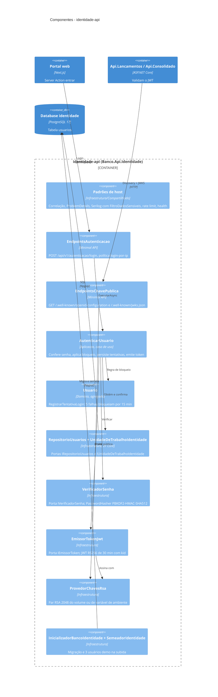
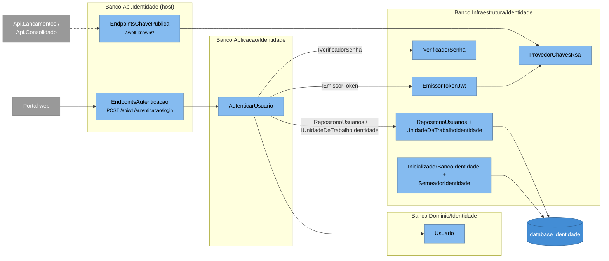

# C4 — Nível 3: Componentes da Identidade

Dentro do container `identidade-api`. O host `Banco.Api.Identidade` só compõe o contexto Identidade
(`AdicionarPadroesBanco` + `AdicionarInfraestruturaIdentidade`); as classes vêm das pastas `Identidade/` de cada
camada (`Banco.Dominio`, `Banco.Aplicacao`, `Banco.Infraestrutura`) e de `Compartilhado/` da Infraestrutura.

**Legenda:** caixa azul-clara dentro da fronteira = componente (classe ou grupo de classes) do container; caixa fora
da fronteira = outro container que o usa; cilindro = database. A camada de cada componente está na tecnologia
(`Dominio`, `Aplicacao`, `Infraestrutura`).

## Mesma visão em flowchart

O layout automático do `C4Component` do Mermaid sobrepõe rótulos; esta visão tem os mesmos componentes, agrupados
por camada (da esquerda para a direita: host → Aplicacao → Dominio/Infraestrutura).

## Elementos

| Elemento | Responsabilidade | Tecnologia |
|---|---|---|
| Padrões de host (`ExtensoesPadroesBanco`) | `MiddlewareCorrelacao` (`X-Correlation-Id`), exceções → Problem Details sem detalhe interno, Serilog JSON com `FiltroDadosSensiveis` (mascara `Authorization`, senha, tokens, cookies), `RateLimiter`, `/health/live` e `/health/ready` | `Banco.Infraestrutura/Compartilhado` |
| `EndpointsAutenticacao` | `POST /api/v1/autenticacao/login` anônimo, com `RequireRateLimiting(login-por-ip)` (30/min por IP); qualquer recusa responde `401` com a mesma mensagem | `Banco.Api.Identidade/Endpoints` |
| `EndpointsChavePublica` | `/.well-known/openid-configuration` (mínimo: `issuer`, `jwks_uri`) e `/.well-known/jwks.json` | `Banco.Api.Identidade/Endpoints` |
| `AutenticarUsuario` | Caso de uso do login. Devolve `null` para usuário inexistente, senha errada ou bloqueado — o chamador não distingue | `Banco.Aplicacao/Identidade` |
| `Usuario` | Agregado com `LimiteFalhasConsecutivas = 5` e `DuracaoBloqueio = 15 min` | `Banco.Dominio/Identidade` |
| `RepositorioUsuarios`, `UnidadeDeTrabalhoIdentidade` | Implementam `IRepositorioUsuarios` (busca por login normalizado) e `IUnidadeDeTrabalhoIdentidade` sobre `IdentidadeDbContext` | EF Core + Npgsql |
| `VerificadorSenha` | Implementa `IVerificadorSenha` com o `PasswordHasher<Usuario>` do ASP.NET Core Identity (formato V3: PBKDF2-HMAC-SHA512, 100 mil iterações, salt) — só o hasher, sem os stores do Identity | `Microsoft.AspNetCore.Identity` |
| `EmissorTokenJwt` | Implementa `IEmissorToken`: `iss=banco-identidade`, `aud=banco-api`, `sub`, `name`, uma claim `role` por papel, `kid` no header, validade 30 min | `Microsoft.IdentityModel.JsonWebTokens` (`JsonWebTokenHandler`) |
| `ProvedorChavesRsa` | `Identidade:Chaves:ChavePrivadaPem` (precedência) ou arquivo `/app/chaves/identidade-rsa.pem` gerado na primeira subida; `kid` = thumbprint JWK (RFC 7638) | RSA 2048 |
| `InicializadorBancoIdentidade`, `SemeadorIdentidade` | `MigrateAsync` com retry e seed idempotente de `consulta`, `operador`, `admin` (senhas de `Identidade:UsuariosDemo`) | EF Core migrations |

## Relações

| Relação | Descrição |
|---|---|
| Portal → `EndpointsAutenticacao` | A Server Action envia login e senha; recebe `tokenAcesso` e `expiraEm` e grava o cookie `sessao` com `maxAge` = expiração |
| APIs → `EndpointsChavePublica` | O `JwtBearer` das APIs lê o discovery uma vez e cacheia as chaves; um `kid` desconhecido força nova leitura |
| `AutenticarUsuario` → `RepositorioUsuarios`/UoW | Grava o novo estado de tentativas **antes** de decidir a resposta — a contagem de falhas não se perde |
| `AutenticarUsuario` → `EmissorTokenJwt` → `ProvedorChavesRsa` | Assinatura assimétrica: só a Identidade tem a chave privada |
| `InicializadorBancoIdentidade` → database | Migração na subida (D13); em produção seria um *migration job* |
