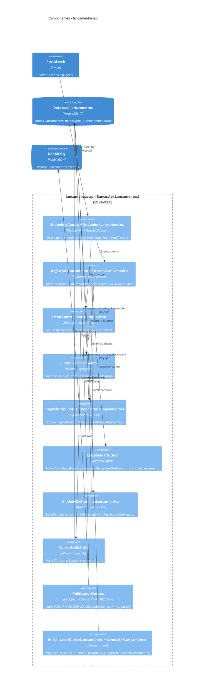
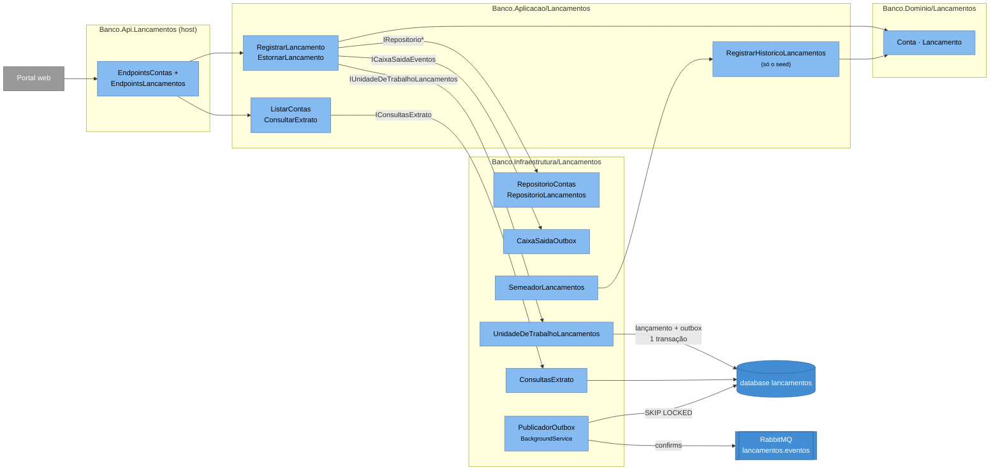

# C4 — Nível 3: Componentes de Lançamentos

Dentro do container `lancamentos-api`. O host `Banco.Api.Lancamentos` compõe só o contexto Lançamentos
(`AdicionarInfraestruturaLancamentos`, `AdicionarPublicadorOutboxLancamentos`, `AdicionarValidacaoLancamentos`).
É o **lado de escrita** e a fonte de verdade; não conhece o Consolidado — só publica o contrato
`LancamentoRegistradoV1` (`Banco.Aplicacao/Compartilhado/Contratos`).

**Legenda:** como no [nível 3 da Identidade](03-componentes-identidade.md): componentes dentro da fronteira,
containers vizinhos fora, camada indicada na tecnologia.

## Mesma visão em flowchart

Mesmos componentes do diagrama C4 acima, agrupados por camada; o rótulo das setas é a **porta** da Aplicacao que a
Infraestrutura implementa.

## Elementos

| Elemento | Responsabilidade | Tecnologia |
|---|---|---|
| `EndpointsContas` | `GET /api/v1/contas` (titular mascarado — `Conta.TitularMascarado`) | Minimal API, `PodeConsultar` |
| `EndpointsLancamentos` | `GET /api/v1/contas/{contaId}/lancamentos` (extrato, `PodeConsultar`); `POST .../lancamentos` e `POST .../lancamentos/{id}/estorno` (`PodeOperar`, `Idempotency-Key` obrigatório). Mapeia `ResultadoLancamento` para `201`, `404`, `409` (segundo estorno) e `422` (chave reutilizada com outro corpo, estorno de estorno, conta inativa) | Minimal API + validadores FluentValidation (`ValidacaoEntrada`) |
| `RegistrarLancamento`, `EstornarLancamento` | Casos de uso de escrita (um por classe, `ExecutarAsync`). Calculam `HashRequisicao` (SHA-256 do corpo normalizado), consultam reenvio (`Idempotencia.ResultadoAnteriorAsync`), criam o agregado, adicionam o evento e confirmam. Perderam a corrida na UNIQUE ⇒ respondem com o lançamento vencedor | `Banco.Aplicacao/Lancamentos` |
| `RegistrarHistoricoLancamentos` | Caso de uso **interno** do seed: mesmo caminho de domínio, instante vindo do item e confirmação em lotes de 1.000. Não é exposto por rota | `Banco.Aplicacao/Lancamentos` |
| `ListarContas`, `ConsultarExtrato` | Leitura; o extrato usa `CursorExtrato` (`ocorrido_em`, `id`) | `Banco.Aplicacao/Lancamentos` |
| `Conta`, `Lancamento` | Agregados: valor `decimal` positivo, tipo `Credito`/`Debito`, `Lancamento.Estornar` gera o compensatório de tipo oposto; um estorno não pode ser estornado | `Banco.Dominio/Lancamentos` |
| `RepositorioContas`, `RepositorioLancamentos` | Um repositório por agregado (sem CRUD genérico); lançamentos só são adicionados | EF Core |
| `CaixaSaidaOutbox` | `ICaixaSaidaEventos.Adicionar` cria `MensagemOutbox` (`Id` = id do lançamento, `Tipo = lancamento.registrado.v1`, `Conteudo` JSON, `IdCorrelacao` da requisição) no mesmo `DbContext` | EF Core |
| `UnidadeDeTrabalhoLancamentos` | `IUnidadeDeTrabalhoLancamentos.ConfirmarAsync`: um `SaveChanges` (transação). SQLSTATE 23505 em `ux_lancamentos_conta_chave_idempotencia`/`ux_lancamentos_estorno_de` volta como `ChaveIdempotenciaDuplicada`/`EstornoDuplicado` | EF Core + Npgsql |
| `ConsultasExtrato` | `IConsultasExtrato`: SQL direto pelo índice `(conta_id, ocorrido_em desc, id)` | EF Core `SqlQuery` |
| `PublicadorOutbox` | `BackgroundService` registrado só neste host. Lote de 100 pendentes (`ORDER BY ocorrido_em ... FOR UPDATE SKIP LOCKED`), publica com `mandatory` e confirms, marca `publicado_em`; falha ⇒ `tentativas++` e backoff 1 s → 30 s | RabbitMQ.Client 7 |
| `InicializadorBancoLancamentos`, `SemeadorLancamentos` | `MigrateAsync` com retry; 5 contas `CC-0001..CC-0005`; histórico de ~1 ano (`PlanoHistorico`) numa **única transação** junto com a marca `historico-lancamentos-v1` em `semeaduras` | EF Core |

## Relações

| Relação | Descrição |
|---|---|
| Portal → endpoints | Server Actions `registrar`/`estornar` enviam `Idempotency-Key` gerada ao abrir o formulário e reenviada em retentativas |
| Casos de uso → repositórios / caixa de saída / UoW | A Aplicacao só conhece portas; o lançamento e a mensagem de outbox entram no mesmo `SaveChanges` |
| UoW → database | A UNIQUE `(conta_id, chave_idempotencia)` decide corridas sem lock distribuído; a UNIQUE `estorno_de` impede segundo estorno |
| `PublicadorOutbox` → database / RabbitMQ | Desacoplado da requisição: o registro nunca espera o broker. O RabbitMQ **não** está no `/health/ready` — com ele fora, a API segue pronta e os eventos acumulam como pendentes |
| Seed → database | Passa pelo caso de uso `RegistrarHistoricoLancamentos`, então gera outbox e o consolidado do histórico é populado pelo fluxo de produção |
