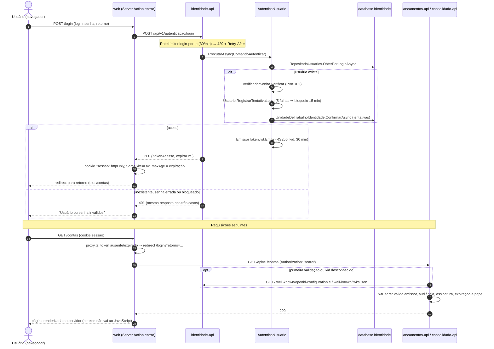
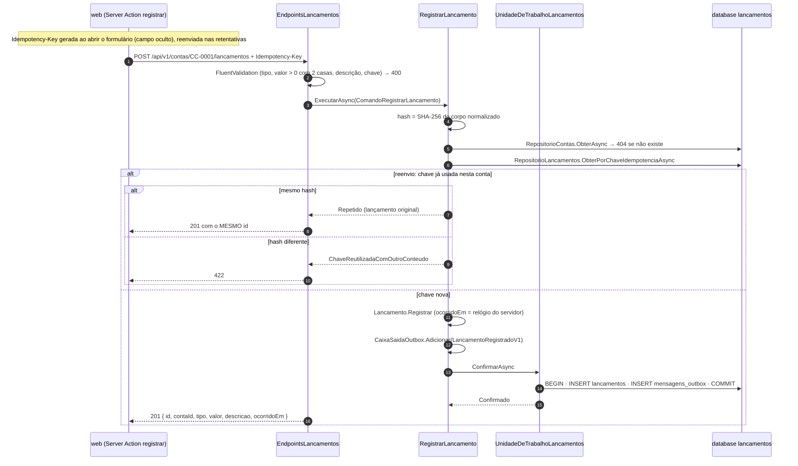
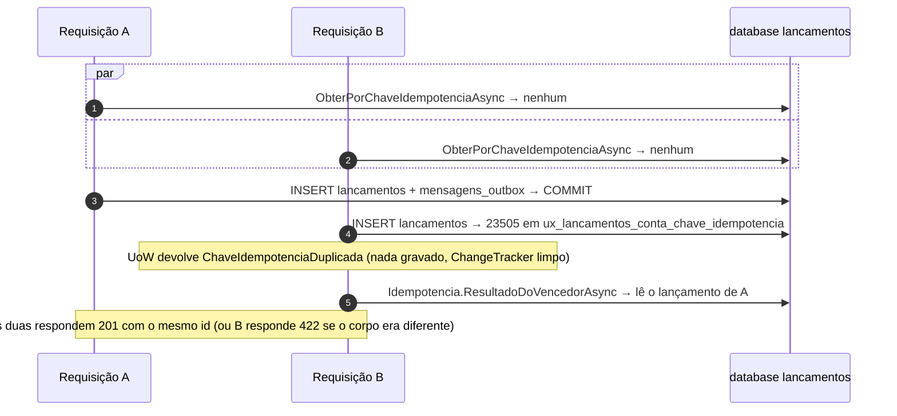
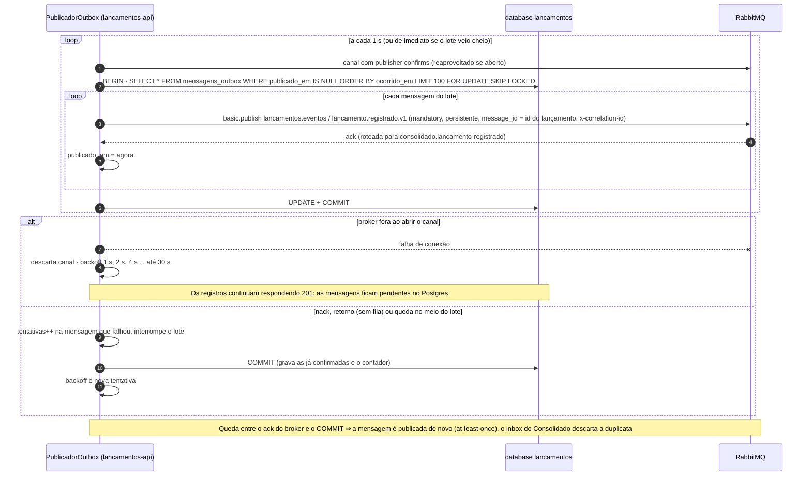
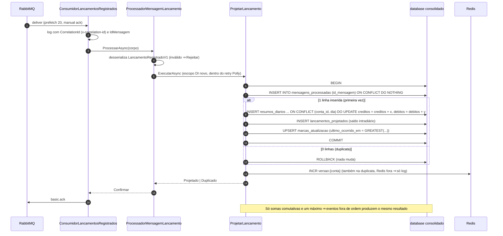
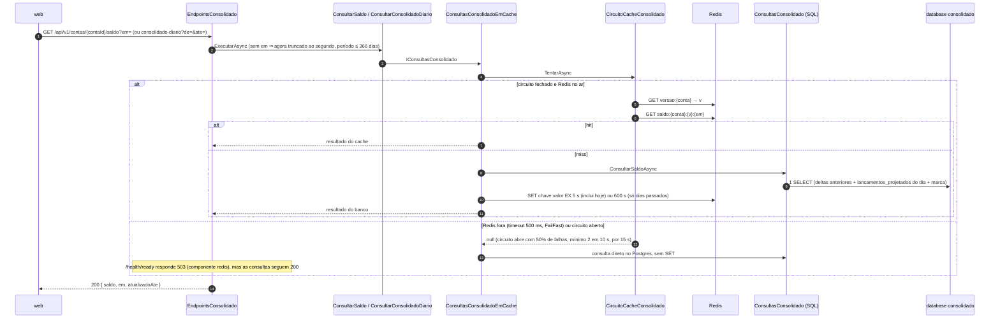
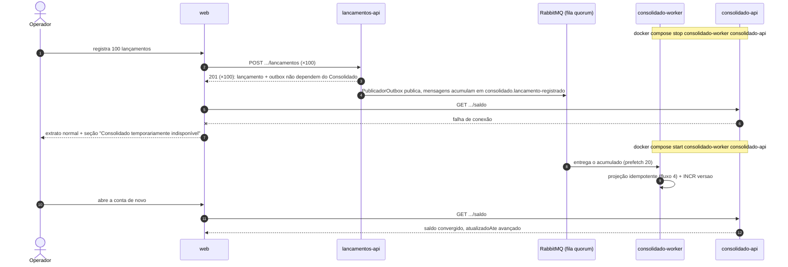
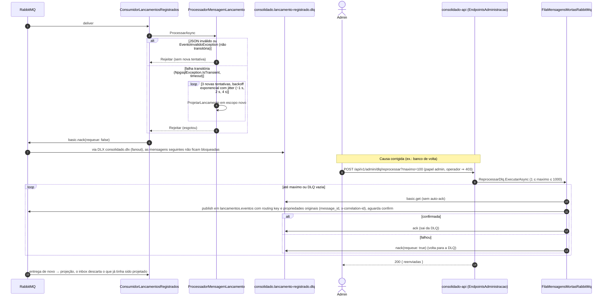

# Fluxos principais e de falha (diagramas de sequência)

Visão dinâmica do C4: como os containers e componentes dos níveis [2](02-containers.md) e
[3](03-componentes-lancamentos.md) colaboram no tempo. Os nomes são os das classes, tabelas, filas e rotas reais.
Cada fluxo indica o teste que o comprova.

**Legenda:** seta cheia (`->>`) = chamada síncrona; seta tracejada (`-->>`) = resposta; `alt` = caminhos
alternativos; `par` = execuções concorrentes; `loop` = repetição; nota amarela = regra ou detalhe relevante.

Sumário:
[1. Login](#1-login) ·
[2. Registro com idempotência](#2-registro-de-lançamento-com-idempotência) ·
[3. Outbox → RabbitMQ](#3-outbox--rabbitmq) ·
[4. Projeção no worker](#4-projeção-no-worker-inbox--upsert--versão) ·
[5. Consulta com cache](#5-consulta-do-consolidado-com-cache) ·
[6. Consolidado fora do ar](#6-consolidado-fora-do-ar-e-recuperação) ·
[7. DLQ e reprocessamento](#7-dlq-e-reprocessamento)

## 1. Login

Testes: `tests/Banco.TestesIntegracao.Identidade/LoginTestes.cs`, `ChavePublicaTestes.cs`;
`web/src/app/login/acoes.test.ts`, `web/src/proxy.test.ts`.

## 2. Registro de lançamento com idempotência

**Corrida** — duas requisições simultâneas com a mesma chave passam juntas pela verificação de reenvio; quem decide
é a UNIQUE do banco, sem lock distribuído:

O estorno (`POST .../lancamentos/{id}/estorno`) segue o mesmo desenho; a UNIQUE `ux_lancamentos_estorno_de` faz o
segundo estorno concorrente virar `409`.

Testes: `tests/Banco.TestesIntegracao.Lancamentos/IdempotenciaTestes.cs` (20 requisições concorrentes com a mesma
chave), `RegistroLancamentoTestes.cs`, `EstornoTestes.cs`, `OutboxTestes.cs`.

## 3. Outbox → RabbitMQ

Por que o RabbitMQ **não** está no `/health/ready` da `lancamentos-api`: tirar a API do ar por causa do broker
derrubaria exatamente o que o outbox existe para proteger.

Testes: `tests/Banco.TestesIntegracao.Lancamentos/PublicacaoOutboxTestes.cs` (broker fora no registro, publicação
depois da volta).

## 4. Projeção no worker (inbox + UPSERT + versão)

Testes: `tests/Banco.TestesIntegracao.Consolidado/ProjecaoLancamentoTestes.cs` (duplicata, fora de ordem, estorno),
`ConsumidorLancamentosTestes.cs` (versão no Redis, correlação no log, falha transitória retentada).

## 5. Consulta do consolidado com cache

Testes: `tests/Banco.TestesIntegracao.Consolidado/CacheConsolidadoTestes.cs` (hit, nova versão, Redis fora,
`/health/ready` 503); carga com Redis parado em [nfr.md](../nfr.md).

## 6. Consolidado fora do ar e recuperação

O mesmo vale para o broker fora (fluxo 3): os eventos ficam no outbox em vez de na fila. Nenhum caminho exige
intervenção manual para convergir.

Testes: `tests/Banco.TestesSistema/RecuperacaoConsolidadoTestes.cs` (compose em execução, `BANCO_TESTES_SISTEMA=1`;
100 de 100 registros `201` e saldo convergido); `web/src/app/(autenticado)/contas/[contaId]/page.test.tsx`
(degradação da seção).

## 7. DLQ e reprocessamento

Testes: `tests/Banco.TestesIntegracao.Consolidado/ReprocessamentoDlqTestes.cs`, `ConsumidorLancamentosTestes.cs`
(mensagem envenenada não bloqueia as seguintes).
