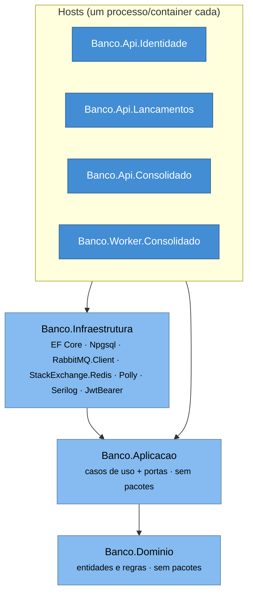
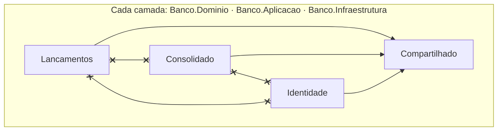

# Arquitetura — índice

Documentação da arquitetura **como foi construída**, no modelo [C4](https://c4model.com/) (Simon Brown), em Mermaid
renderizado pelo GitHub. 

## O modelo C4 em uma linha por nível

| Nível | Pergunta que responde | Documento |
|---|---|---|
| 1 — Contexto | Quem usa o sistema e com o que ele conversa? | [01-contexto.md](01-contexto.md) |
| 2 — Containers | Quais processos e armazenamentos existem, e como se falam? | [02-containers.md](02-containers.md) |
| 3 — Componentes | O que há dentro de cada container (endpoints, casos de uso, portas, adaptadores)? | [Identidade](03-componentes-identidade.md) · [Lançamentos](03-componentes-lancamentos.md) · [Consolidado](03-componentes-consolidado.md) |
| Dinâmico | Como os fluxos principais e de falha acontecem no tempo? | [04-fluxos.md](04-fluxos.md) |

O nível 4 (código) não é desenhado: o código e os nomes de classe citados nas tabelas cumprem esse papel.

Cada diagrama tem **legenda** e duas tabelas: *Elemento | Responsabilidade | Tecnologia* e *Relação | Descrição*.
Nos níveis 2 e 3 há, além do diagrama em notação C4 do Mermaid (`C4Container`/`C4Component`, cujo layout automático
sobrepõe rótulos quando há muitas setas), uma **visão em flowchart** com os mesmos elementos e as cores da notação C4,
mais fácil de ler.

## Decisões e números

- Por que cada coisa é como é: [decisões arquiteturais](../decisoes-arquiteturais.md) e [ADRs](../adr/README.md).
- Metas não funcionais e resultados medidos (carga de 50 req/s): [nfr.md](../nfr.md) e [teste-carga/](../teste-carga/).
- O que vem depois: [evolucao.md](../evolucao.md).

## Organização do código: Clean Architecture por camada, um host por serviço

Os serviços são **processos separados** (um container por host), mas o código é organizado **por camada**, com um
projeto por camada e, dentro dele, uma pasta (namespace) por contexto: `Compartilhado`, `Identidade`,
`Lancamentos` e `Consolidado`. Decisão do autor — trade-offs em
[D2](../decisoes-arquiteturais.md#d2-clean-architecture-organizada-por-camada-com-um-host-por-serviço) e no
[ADR 0002](../adr/0002-clean-architecture-por-camada-com-hosts-separados.md).

```text
src/
  Banco.Dominio/            Compartilhado/ · Identidade/ (Usuario) · Lancamentos/ (Conta, Lancamento)
                            · Consolidado/ (ResumoDiario, Movimento, CalculadoraSaldo)          — sem pacote algum
  Banco.Aplicacao/          Compartilhado/Contratos/ (LancamentoRegistradoV1) · Identidade/ · Lancamentos/ · Consolidado/
                            casos de uso (uma classe, ExecutarAsync) + portas em Portas/      — só referencia o Dominio
  Banco.Infraestrutura/     Compartilhado/ (JWT, Serilog, correlação, ProblemDetails, rate limit, health, RabbitMQ)
                            Identidade/ · Lancamentos/ · Consolidado/ (DbContext, repositórios, UoW, outbox,
                            consumidor, cache, consultas SQL; extensão de DI por contexto)
  Banco.Api.Identidade/     host HTTP — compõe só Identidade
  Banco.Api.Lancamentos/    host HTTP — compõe só Lancamentos (+ PublicadorOutbox)
  Banco.Api.Consolidado/    host HTTP — compõe só Consolidado (consultas + DLQ)
  Banco.Worker.Consolidado/ host sem HTTP — compõe só Consolidado (consumidor)
tests/
  Banco.TestesUnitarios/                         domínio, aplicação, padrões de host, regras de arquitetura (NetArchTest)
  Banco.TestesIntegracao.{Identidade,Lancamentos,Consolidado}/   WebApplicationFactory + Testcontainers
  Banco.TestesSistema/                           contra o compose em execução
  carga/consolidado.js                           k6
web/                        Next.js 16 (App Router), BFF
```

### Regra de dependência



As setas apontam para **dentro**: o domínio não conhece nada; a Aplicacao declara portas (`IRepositorioLancamentos`,
`IUnidadeDeTrabalhoLancamentos`, `ICaixaSaidaEventos`, `IConsultasConsolidado`, `IEmissorToken`, ...) que a
Infraestrutura implementa; os hosts traduzem HTTP/mensagem ⇄ caso de uso e fazem a composição de DI.

### Isolamento entre contextos (dentro de cada camada)



`tests/Banco.TestesUnitarios/Arquitetura/RegrasDeArquiteturaTestes.cs` (NetArchTest, inspeciona o IL) garante:

- `Banco.Dominio` não depende de pacote nem de outro projeto;
- `Banco.Aplicacao` depende **somente** de `Banco.Dominio` (lista fechada: EF Core, ASP.NET, Npgsql, RabbitMQ ou Redis
  ali quebram o teste);
- para cada camada × contexto, nenhum tipo de `Banco.{Camada}.{Contexto}` usa tipos de outro contexto — só
  `Compartilhado`. Lançamentos e Consolidado se falam **apenas** pelo contrato `LancamentoRegistradoV1` via RabbitMQ.

A segunda barreira é a **composição por host**: cada `Program.cs` registra só as extensões do seu contexto
(`AdicionarInfraestruturaLancamentos`, `AdicionarConsultasConsolidado`, ...), então um host não tem como resolver um
serviço de outro contexto em tempo de execução.
